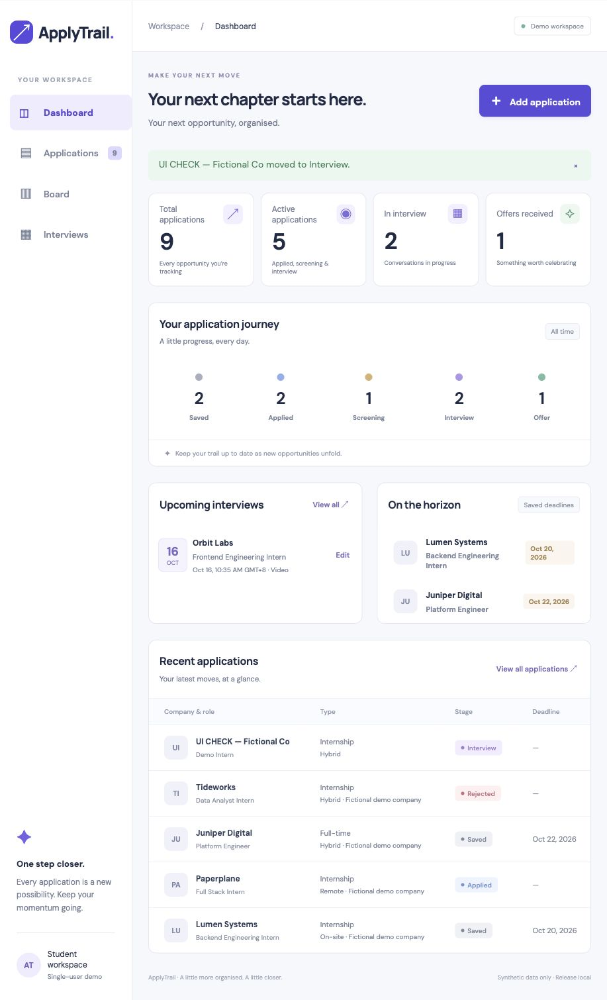
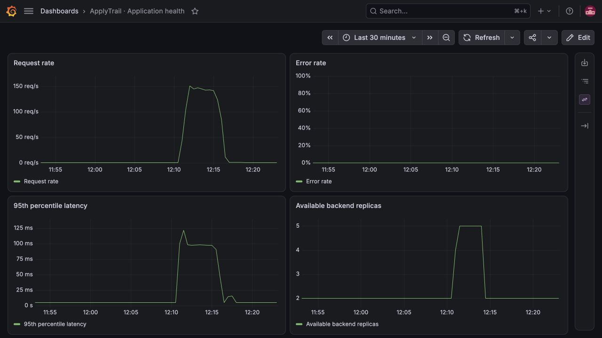
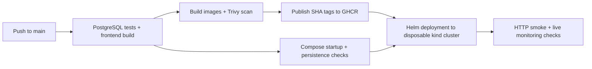

# ApplyTrail

**Your next opportunity, organised.**

ApplyTrail helps you track job and internship applications, interviews and deadlines in one place. Save opportunities, update their stages, and see what needs your attention next.

[](https://github.com/Prisha4gupta/ApplyTrail/actions/workflows/delivery.yml)

[Get started](#get-started) · [Kubernetes setup](docs/local-kubernetes.md) · [Architecture](docs/architecture.md) · [Troubleshooting](docs/troubleshooting.md)



## Features

- **Dashboard:** total and active applications, interview-stage applications, offers, upcoming interviews and saved deadlines.
- **Application tracking:** create, edit and delete applications; search by company or role; filter, sort and paginate results.
- **Board view:** see opportunities grouped by stage and update their status using keyboard-accessible controls.
- **Interview planning:** schedule, edit and remove interviews, with times displayed in your local timezone.
- **Persistent data:** PostgreSQL stores applications and interviews, with Alembic-managed schema changes.
- **Responsive interface:** usable forms, navigation and tables on desktop and mobile.

Stages are **Saved, Applied, Screening, Interview, Offer, Rejected and Withdrawn**. Active applications are those in Applied, Screening or Interview. Interview and offer counts describe application stages, not appointment counts. Deleting an application also deletes its linked interviews.

This version is a single-user application without authentication. Use fictional data for demonstrations and keep it on a trusted local network. Authentication, HTTPS and backups are needed before using it as a public service with personal information.

## Technology

| Layer | Tools |
|---|---|
| Frontend | React, TypeScript, Vite, Nginx |
| Backend | FastAPI, Pydantic, SQLAlchemy |
| Database | PostgreSQL, Alembic |
| Tests | Pytest, HTTPX |
| Containers | Docker, Docker Compose |
| Delivery | GitHub Actions, GHCR, Trivy |
| Kubernetes | Helm, kind, Traefik, Metrics Server |
| Monitoring | Prometheus, Grafana |
| Optional infrastructure | Terraform, AWS EKS |

Dependencies are pinned in the Python requirements, npm lockfile and Terraform provider lockfile. Supporting Helm chart versions are pinned in the setup scripts.

## Get started

Install Docker Desktop with Docker Compose and make sure Docker is running.

```bash
git clone https://github.com/Prisha4gupta/ApplyTrail.git
cd ApplyTrail
cp .env.example .env
```

If you already have a `.env` file, keep your existing configuration. Replace its password placeholders with the same randomly generated, URL-safe password in both `POSTGRES_PASSWORD` and `DATABASE_URL`. The file is ignored by Git.

```bash
docker compose up --build -d
docker compose ps -a
```

Open **[localhost:3000](http://localhost:3000)**. API documentation is available at [localhost:8000/docs](http://localhost:8000/docs).

The migration container finishes with exit code `0`; frontend, backend and database stay running. To add fictional sample applications:

```bash
docker compose run --rm backend python -m app.seed
```

Seeding is optional, never runs automatically, and does not duplicate existing seed records.

### Everyday commands

```bash
# Follow service logs
docker compose logs -f backend frontend postgres migrate

# Verify the application through its frontend
python3 scripts/smoke.py http://localhost:3000

# Check persistence after restarting application containers
python3 scripts/compose-check.py

# Stop containers while preserving database data
docker compose down
```

`docker compose down -v` permanently deletes the local database volume. See [cleanup](docs/cleanup.md) before removing stored data.

## Development and tests

For backend development, use Python 3.12:

```bash
# From the repository root
python3.12 -m venv .venv
.venv/bin/pip install -r backend/requirements.txt
cd backend
../.venv/bin/pytest -v
```

The 16 API tests cover CRUD, filtering, pagination, validation, interviews, cascading deletion, dashboard calculations, readiness and metrics. Local tests use isolated SQLite; CI uses isolated PostgreSQL. Never point `TEST_DATABASE_URL` at data you want to keep.

For frontend development, use Node.js 24.15.0:

```bash
# From the repository root
cd frontend
npm ci
npm run dev
# Production check:
npm run build
```

Vite serves port 5173 and forwards `/api` to the backend on port 8000. You can keep the Compose backend running while developing the frontend.

## API overview

| Method | Endpoint | Purpose |
|---|---|---|
| GET / POST | `/api/applications` | List or create applications |
| GET / PUT / DELETE | `/api/applications/{id}` | Read, edit or delete an application |
| GET | `/api/dashboard` | Counts, interviews and deadlines |
| GET | `/api/interviews` | List interviews |
| POST | `/api/applications/{id}/interviews` | Schedule an interview |
| PUT / DELETE | `/api/interviews/{id}` | Edit or remove an interview |
| GET | `/api/version` | Running release identifier |
| GET | `/health` | Process liveness |
| GET | `/ready` | Database connectivity |
| GET | `/metrics` | Prometheus metrics |

Required fields, stage values, HTTP/HTTPS job URLs and timezone-aware interview timestamps are validated. Creation returns `201`, deletion `204`, missing records `404`, and invalid input `422`. Historical dates are supported.

## Kubernetes and monitoring

The [Kubernetes guide](docs/local-kubernetes.md) runs ApplyTrail in Docker Desktop using kind and Helm:

- Two frontend replicas and a backend HPA scaling from two to five replicas.
- Traefik routing `/` to the frontend and `/api` to the backend at **localhost:8080**.
- PostgreSQL persistent storage and a migration Job per release.
- Health probes, resource limits and non-root application containers.
- Prometheus scraping and Grafana panels for traffic, errors, latency and replicas.



The local setup has been checked through CRUD, database pod recreation, live monitoring, autoscaling and recovery from a Service-selector fault. A 90-second load run completed 46,894 requests without failures and triggered backend scaling from two to five replicas.

## Continuous delivery



Each application image is built once, scanned for HIGH/CRITICAL vulnerabilities and published with its full commit SHA. The Kubernetes job deploys those same images, verifies the application and monitoring, then deletes its disposable cluster. Test and scan reports are available as GitHub Actions artifacts.

See the [successful Kubernetes delivery run](https://github.com/Prisha4gupta/ApplyTrail/actions/runs/38849684438). This deployment runs on the GitHub runner; it does not update your laptop automatically.

Optional EKS configuration is provided under `terraform/`. Its separate deployment job requires `ENABLE_EKS_DEPLOY=true` and environment-specific settings. See [cloud deployment](docs/cloud-deployment.md) for prerequisites, costs and setup.

## Repository structure

```text
backend/       API, database models, migrations and tests
frontend/      React application and Nginx configuration
helm/          Application chart and local overrides
k8s/           Cluster, Ingress, storage and access configuration
monitoring/    Prometheus/Grafana configuration and dashboard
terraform/     Optional cloud infrastructure configuration
scripts/       Setup, smoke, load and recovery checks
docs/          Architecture, deployment and maintenance guides
.github/       Automated testing, scanning and delivery
```

For maintenance, see [architecture](docs/architecture.md), [troubleshooting](docs/troubleshooting.md) and [cleanup](docs/cleanup.md).
