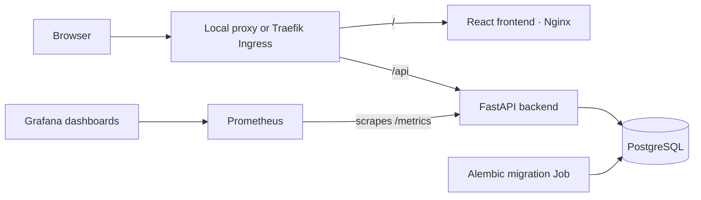
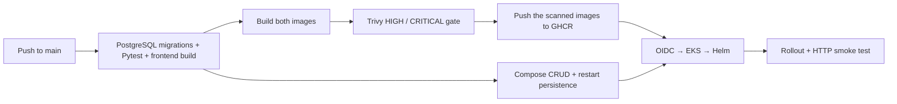

<div align="center">

# ApplyTrail

### Your next opportunity, organised.

An internship and job application tracker built to make the application process easier to manage—and to demonstrate how a real application moves from source code to a tested, containerised, monitored deployment.

**React · TypeScript · FastAPI · PostgreSQL · Docker · GitHub Actions · Terraform · Kubernetes**

[Getting started](#run-applytrail-locally) · [Step-by-step guide](docs/next-steps.md) · [Architecture](docs/architecture.md) · [Verification & evidence](docs/evidence-checklist.md)

</div>

---

## About the project

Applying for internships and jobs often means keeping track of scattered job links, application dates, interview appointments and follow-ups. ApplyTrail brings those details into one workspace so a student can see where each opportunity stands and decide what needs attention next.

You can save a role before applying, update its stage as you progress, record interviews, and review your pipeline from a dashboard or board. The application is intentionally focused: it does not scrape job listings, send emails, upload resumes or depend on paid APIs.

ApplyTrail also serves as a DevOps capstone. Alongside the application, this repository contains automated tests, container definitions, a security-gated delivery workflow, AWS infrastructure code, Kubernetes packaging, monitoring configuration and documented demonstration procedures.

> **Demo scope:** ApplyTrail currently has no user authentication. It is a single-user demonstration using fictional data. Anyone who can reach a publicly deployed instance can access and modify its records. Do not enter real personal information.

## A look at ApplyTrail


*Actual local browser capture. This screenshot demonstrates the interface; it is not evidence of an AWS deployment.*

## What you can do

| Area | Capabilities |
|---|---|
| **Dashboard** | Review total applications, active applications, interview-stage applications and offers. See upcoming interviews and deadlines for saved opportunities. |
| **Applications** | Create, inspect, edit and delete records. Search by company or role, filter by stage/employment type, sort by update time/deadline, and paginate results. |
| **Board** | See applications grouped by stage and move them using accessible dropdown controls. Stage changes persist in the database. |
| **Interviews** | Add, edit and delete interview appointments, record their type and notes, and view times in your local timezone. |
| **Demo data** | Explicitly load fictional opportunities using an idempotent seed command. Existing seed records are not duplicated. |

The application stages are:

**Saved → Applied → Screening → Interview → Offer**, with **Rejected** and **Withdrawn** available when an opportunity closes.

Stages are editable rather than enforced as a rigid sequence, so historical records and different recruitment processes are supported.

### What the dashboard numbers mean

- **Total applications:** every application record, including saved and closed opportunities.
- **Active applications:** applications currently in Applied, Screening or Interview.
- **In interview:** applications currently in the Interview stage—not the number of interview appointments.
- **Offers received:** applications currently in the Offer stage.
- **Upcoming interviews:** the next five scheduled interviews at or after the current time.
- **Saved deadlines:** the next five deadlines on or after the user's local date for applications still in Saved.

The dashboard does not display a misleading “success rate” derived from these different categories.

## How the system works



The frontend sends relative `/api` requests. Vite forwards those requests during development, Nginx handles them in Docker Compose, and Traefik routes them in Kubernetes. The backend validates input, applies the application rules and stores records through SQLAlchemy. Alembic versions the database schema separately from normal application startup.

### Technology choices

| Layer | Technology | Purpose |
|---|---|---|
| Interface | React, TypeScript, Vite, CSS | Responsive views, typed client code and production builds |
| API | FastAPI, Pydantic, Uvicorn | REST endpoints, input validation and generated API documentation |
| Database | PostgreSQL, SQLAlchemy, Alembic | Persistent relational records, constraints and controlled schema changes |
| Tests | Pytest, HTTPX | Isolated API and database behavior checks |
| Containers | Docker, Docker Compose, Nginx | Reproducible local stack and non-root application runtimes |
| Delivery | GitHub Actions, GHCR | Automated checks, image publication and deployment |
| Security | Trivy, GitHub OIDC | Container vulnerability gate and temporary AWS authentication |
| Infrastructure | Terraform, AWS VPC, EKS, IAM, EBS CSI | Network, cluster, worker nodes, access and persistent storage |
| Deployment | Helm, Kubernetes, Traefik, Metrics Server | Release management, routing, probes and CPU autoscaling |
| Monitoring | Prometheus, Grafana | Request rate, errors, latency and replica visibility |

Exact dependencies are recorded in the Python requirements, npm lockfile and Terraform provider lockfile. Chart versions are pinned in the bootstrap script. See [version decisions](docs/versions.md).

## Data and API

An **application** contains company and role names, employment type, work mode, stage, optional location/job URL, application date, deadline and notes. It also records creation and update timestamps.

An **interview** belongs to an application and contains its scheduled time, type and notes. PostgreSQL stores timezone-aware interview timestamps; the browser displays local time. Deleting an application also deletes its related interviews through an explicit foreign-key cascade.

Required fields, allowed values, HTTP/HTTPS job URLs and timestamp formats are validated. Valid historical dates are accepted.

| Method | Endpoint | Purpose |
|---|---|---|
| GET / POST | `/api/applications` | List/filter applications or create a record |
| GET / PUT / DELETE | `/api/applications/{id}` | Read, replace or delete an application |
| GET | `/api/dashboard` | Dashboard counts and upcoming items |
| GET | `/api/interviews` | List interview appointments |
| POST | `/api/applications/{id}/interviews` | Add an interview to an application |
| PUT / DELETE | `/api/interviews/{id}` | Update or delete an interview |
| GET | `/api/version` | Running release identifier |
| GET | `/health` | Lightweight process liveness |
| GET | `/ready` | Database connectivity readiness |
| GET | `/metrics` | Prometheus metrics |

With the local stack running, explore the interactive API documentation at [localhost:8000/docs](http://localhost:8000/docs). Creation returns 201, deletion returns 204, missing records return 404, invalid requests return 422, and database unavailability returns 503.

## Run ApplyTrail locally

Install and start Docker Desktop with Docker Compose. You do not need to install PostgreSQL separately for this route.

```bash
cd /path/to/ApplyTrail
cp .env.example .env
```

Edit `.env` and replace the password placeholder in **both** `POSTGRES_PASSWORD` and `DATABASE_URL` with the same randomly generated, URL-safe password. Keep `.env` private; it is excluded from Git. If `.env` already exists, keep its existing configuration instead of overwriting it.

```bash
docker compose up --build -d
docker compose ps -a
docker compose run --rm backend python -m app.seed
```

Open **[http://localhost:3000](http://localhost:3000)**. The seed command is optional and never runs automatically at startup. The migration container should finish with exit code 0; frontend, backend and PostgreSQL should remain running.

```bash
# Follow service logs; Ctrl+C only stops following the logs.
docker compose logs -f backend frontend postgres migrate

# Stop the stack while keeping the database volume.
docker compose down
```

**Destructive reset:** `docker compose down -v` permanently removes local database data. Use it only when you deliberately want a fresh database.

For direct Python/Node development, SQLite preview limitations, configuration details and manual migrations, see the [operations reference](docs/operations.md). For a beginner-friendly walkthrough tailored to this project, start with [Your next steps](docs/next-steps.md).

## Testing and verification

```bash
# From the repository root, with dependencies installed in .venv:
(cd backend && ../.venv/bin/pytest -v)
(cd frontend && npm ci && npm run build)

# With Docker Compose running:
python3 scripts/smoke.py http://localhost:3000
python3 scripts/compose-check.py
```

The API suite covers creation, retrieval, filtering, pagination, stage updates, deletion, invalid requests, missing records, interview CRUD/cascades, dashboard calculations, readiness failure and bounded metric labels. Local tests default to isolated SQLite; CI uses a dedicated PostgreSQL database named `applytrail_test`. Tests must never target demonstration or deployed data.

The HTTP smoke test creates uniquely identifiable fictional records and cleans them up. The Compose check verifies that an application survives restarting the frontend and backend containers.

## From commit to deployment



Images use the full Git commit SHA as their tag. Each image is built once, scanned and then pushed; the publish step does not rebuild it. Scan artifacts are retained even when a scan fails. Deployment waits for the image and Compose jobs, and GitHub concurrency prevents overlapping releases.

The workflow uses GitHub OIDC instead of committed AWS access keys. The deployment identity is limited to the target cluster and application namespace, with explicit access for ServiceMonitor resources. AWS infrastructure provisioning is a separate, approved operation; CI does not automatically run Terraform apply.

## Kubernetes and observability

The Helm chart provides two frontend replicas, a backend HPA with a minimum of two replicas, ClusterIP Services, readiness/liveness probes, resource requests/limits, a PostgreSQL StatefulSet with persistent storage, and Ingress routes for `/` and `/api`. A controlled migration Job runs once per release rather than from every backend replica.

Prometheus scrapes request counters and duration histograms. Labels use route templates, methods and response statuses rather than raw application IDs or personal content. The provisioned Grafana dashboard shows request rate, server-error rate, latency and available backend replicas. Grafana uses private access through port forwarding.

These configurations have been rendered and checked locally. Actual EKS operation, live monitoring, autoscaling and recovery still require cloud verification.

## Current verification status

The recorded [CI run](https://github.com/Prisha4gupta/ApplyTrail/actions/runs/38586804223) verifies the following at commit `b547f76`:

| Area | Recorded result |
|---|---|
| PostgreSQL migrations and 16 API tests | Passed in CI |
| Frontend production build | Passed in CI |
| Frontend and backend image builds | Passed in CI |
| Both Trivy HIGH/CRITICAL gates | Passed in CI after remediation |
| Both GHCR image pushes | Passed in CI |
| Compose startup, CRUD and restart persistence | Passed in CI |
| Helm rendering and Terraform validation | Passed locally |
| Browser create/stage change and mobile layout | Verified locally; scope recorded in evidence |
| AWS deployment | Blocked at missing AWS authentication/bootstrap |
| Live Prometheus/Grafana, HPA, recovery and destroy | Pending actual AWS deployment/evaluation |

The full workflow is **not green end to end**: its deployment job failed at AWS authentication. An earlier backend scan also failed; both the original findings and successful remediation reports are preserved in [security results](docs/security-results.md). This repository does not claim cloud resources or evidence that have not been observed.

## Deployment, costs and cleanup

The proposed AWS demo uses Mumbai (`ap-south-1`), EKS 1.35, two `t3.medium` workers, public subnets, EBS-backed database storage and an Ingress load balancer. Public nodes avoid a NAT gateway for this short-lived demonstration; they are a deliberate cost/security tradeoff. A longer-lived production design would need stronger network isolation and further hardening.

**AWS is chargeable.** Review a current regional estimate, intended runtime and cleanup policy before approving provisioning. Do not assume student credits or free-tier coverage. The [AWS bootstrap guide](docs/aws-bootstrap.md) contains the proposal and the [cleanup guide](docs/cleanup.md) explains the teardown sequence. Do not destroy the environment before assessment and confirmation.

## Project structure

```text
ApplyTrail/
├── frontend/                 React interface, styles and Nginx container
├── backend/
│   ├── app/                  API, models, validation, metrics and demo seed
│   ├── alembic/              Versioned database migrations
│   └── tests/                Isolated API tests
├── .github/workflows/        Verification, security and delivery pipeline
├── docker-compose.yml       Local application/database stack
├── terraform/               AWS network, EKS, IAM and storage integration
├── helm/applytrail/          Application deployment chart
├── k8s/                     Namespace, storage, controller values and RBAC
├── monitoring/              Prometheus/Grafana values and dashboard
├── scripts/                 Bootstrap, deployment, smoke and load checks
├── docs/                    Guides, architecture, audit and demonstration
└── evidence/                Genuine logs, reports and screenshots
```

## Guides and project records

| Document | Read it when you want to… |
|---|---|
| [Your next steps](docs/next-steps.md) | Follow the remaining work in order, with commands and expected results |
| [Operations reference](docs/operations.md) | Find development, configuration and runtime commands |
| [Architecture](docs/architecture.md) | Understand the components, data flow and tradeoffs |
| [AWS bootstrap](docs/aws-bootstrap.md) | Prepare account access, state, costs and runtime secrets |
| [Troubleshooting](docs/troubleshooting.md) | Diagnose failures, practise recovery and understand rollback |
| [Demo script](docs/demo-script.md) | Present a complete code-to-deployment demonstration |
| [Evidence checklist](docs/evidence-checklist.md) | Know what to capture and what each artifact proves |
| [Rubric matrix](docs/rubric-matrix.md) | Map assessment requirements to implementation and verification |
| [Viva preparation](docs/viva-preparation.md) | Explain the engineering choices in your own words |
| [Cleanup](docs/cleanup.md) | Remove resources safely after evaluation |
| [Progress](docs/progress.md) | Review the implementation and verification history |

## Limitations and future work

Authentication, multi-user isolation, production TLS, managed database HA, durable monitoring storage and tested backups are outside the current implementation. The PostgreSQL volume provides persistence, not high availability or a backup. Application rollback also does not safely reverse database schema changes automatically.

The goal is a focused, understandable application with a demonstrable delivery process. Completion of the capstone still depends on the remaining real deployment and evidence work described above.
