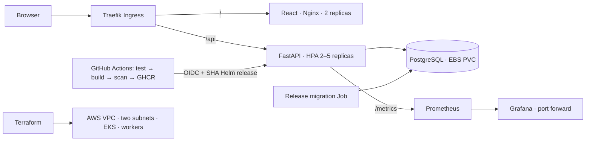

# Architecture

The frontend uses relative /api URLs: Vite proxies in development; Nginx proxies in Compose; Traefik preserves the /api prefix in Kubernetes. No frontend secrets. Operational endpoints are backend-only; /api/version exposes the running commit. Each backend process exports its own metrics and Prometheus aggregates across replicas.

Applications own interviews: database ON DELETE CASCADE removes linked interviews. UTC-aware timestamps are stored in PostgreSQL; browsers display local time. Historical dates remain valid. Active means Applied + Screening + Interview; interview/offer counts are current application stages, not event counts or success rates. Upcoming interviews are the next five events at or after the current instant. Deadlines are the next five Saved application deadlines on or after the user's calendar day (UTC fallback). The Interviews view includes historical events. Board pagination limits each page to 100 records and explicitly reports page-local counts.

This is an unauthenticated, single-user, synthetic-data demonstration. Anyone who can reach its public Ingress can read/change/delete its records. It is not a private job-search service. No real personal information belongs here. Production would need authentication/authorization, TLS, managed backups, rate limiting, disaster recovery and likely managed PostgreSQL.

Public workers in two public subnets are an explicit short-lived cost tradeoff: public IPs provide image-pull egress without NAT. No SSH access is configured. Prefer private workers + NAT/endpoints for a lasting environment. EKS API has private access plus configurable public CIDRs. Standard GitHub-hosted runner egress is not fixed: either supply a runner with static egress or explicitly approve a wider API allowlist. IAM/OIDC authentication still gates API use.

PostgreSQL is one replica: PVC persistence is not database HA. gp3 retains the volume on claim deletion; cleanup must explicitly account for it. EBS is AZ-bound. Keep nodes in the volume's AZ when replacing capacity. Monitoring is short-retention, ephemeral demo storage; no durability claim is made for metrics.
