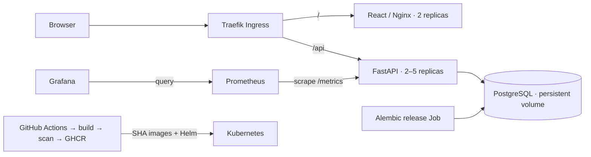

# Architecture

## Request flow

The frontend uses relative `/api` URLs. Vite proxies them during development, Nginx handles them in Compose, and Traefik preserves the prefix in Kubernetes. Browser code contains no secrets. `/api/version` identifies the running release; health, readiness and metrics endpoints are served by the backend.

## Data model

Applications hold the company, role, employment type, work mode, stage, optional job URL, deadlines and notes. Interviews belong to an application through a foreign key. Deleting an application cascades to its interviews. PostgreSQL stores timezone-aware timestamps; browsers display local time. Alembic manages schema changes separately from application startup.

Active applications are those in Applied, Screening or Interview. Upcoming interviews are the next five events at or after the current time. Saved deadlines are the next five on or after the user's calendar day. Board pagination reports counts for the current page.

## Runtime

Helm manages the application Deployments, Services, Ingress, PostgreSQL StatefulSet and migration Job. Backend autoscaling uses CPU utilization with a 100m CPU request, a 65% target and two to five replicas. The release does not override replicas managed by the HPA.

The local kind cluster uses the `standard` storage class and a localhost NodePort mapping. Optional EKS configuration uses EBS gp3 storage, two public subnets and a managed node group. Local replicas share one Docker node, so they do not provide multi-machine availability. PostgreSQL has one replica; persistent storage is not database high availability.

## Monitoring

Each backend process exports request counters and duration histograms. Prometheus scrapes each replica through a ServiceMonitor, and Grafana aggregates across replicas. Metric labels use bounded route templates, methods and response statuses. Monitoring has six-hour retention and ephemeral storage, suitable for development rather than long-term reporting.

## Security boundaries

The application is single-user and has no authentication. Keep demonstrations limited to fictional data. A public deployment with personal information needs authentication, authorization, TLS, backups and rate limiting. Database and Grafana credentials are generated at runtime and referenced through Secrets; they are not committed. Grafana is accessed using localhost port forwarding.
